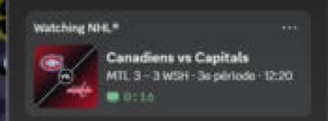
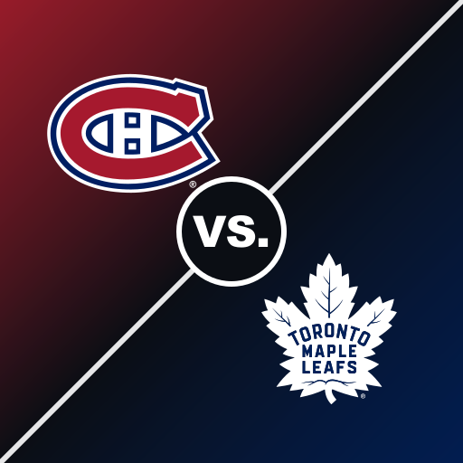
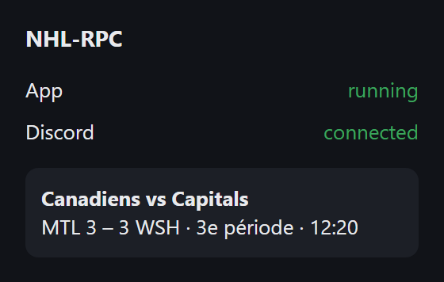

# NHL-RPC

Discord Rich Presence for [onhockey.tv](https://onhockey.tv/): your Discord status shows the hockey game you're watching, with the live score, period and time remaining.



- **Line 1:** the game, e.g. `Canadiens vs Capitals`
- **Line 2:** live score + period + clock, e.g. `MTL 3 – 3 WSH · 3e période · 12:20`, `2e entracte · 4:51`, `Final (prol.)`
- **Image:** a matchup poster built from both teams' official logos



Your status reads « Watching Canadiens vs Capitals ». Hovering the image shows the full team names and shots on goal. A « Gamecenter NHL.com » button and the time you've been watching are shown too. The presence text is in French.

Live scores are available for **NHL** games. For other leagues (KHL, AHL, Liiga…), the presence shows the game and the league, without score.

## Requirements

- Windows 10 or 11
- The **Discord desktop app** (Discord in a web browser can't show Rich Presence)
- A Chromium browser: **Chrome, Edge, Brave or Opera**
- Node.js 20 or newer. If it's missing, the installer offers to install it.

## Installation

**1. Download**

Click **Code → Download ZIP** at the top of this page, then extract it to a folder you'll keep (for example `Documents\NHL-RPC`).
If you use git: `git clone https://github.com/TheUnknownMurda/NHL-RPC.git`

> Don't move the folder after installing. If you do, run `install.bat` again and reload the extension.

**2. Run `install.bat`**

Double-click `install.bat` and answer the questions. It:

1. checks Node.js and installs it if needed
2. installs the dependencies
3. asks if NHL-RPC should start with Windows (recommended)
4. starts NHL-RPC in the background
5. copies the extension folder path to your clipboard and opens your browser's extensions page

**3. Load the browser extension**

On the extensions page that opened (`chrome://extensions` or `edge://extensions`):

1. Turn on **Developer mode** (top right in Chrome, left menu in Edge)
2. Click **Load unpacked**
3. Paste the path from your clipboard (`Ctrl+V`) in the folder box, or select the `extension` folder yourself
4. Pin the extension (puzzle icon → pin): its popup shows whether everything is connected



**That's it.** Open Discord, go to onhockey.tv, click a game, then a stream link: your status updates within a few seconds.

## Usage

The presence appears when you click a stream link on onhockey.tv. It disappears when you close the tab, go back to the onhockey.tv home page, or about 45 s after closing the browser. Opening a stream in a new tab (middle-click) works too.

| File | What it does |
| --- | --- |
| `install.bat` | Installs or repairs NHL-RPC (safe to run again) |
| `start.bat` | Restarts NHL-RPC in a window where you can see the logs |
| `stop.bat` | Stops NHL-RPC and clears your Discord status |
| `uninstall.bat` | Stops NHL-RPC and removes it from Windows startup |

## Troubleshooting

Click the extension icon first: the popup tells you what's wrong.

| Problem | Fix |
| --- | --- |
| Popup: *App: not found* | NHL-RPC isn't running. Run `start.bat`; the window shows any error. |
| Popup: *Discord: not connected* | Open the Discord desktop app. NHL-RPC reconnects by itself within 15 s. |
| Everything is connected but nobody sees the status | Discord → User Settings → **Activity Privacy** → turn on **Share your detected activities with others**. |
| No score shown | Live scores exist only for NHL games. |
| The image is the default one instead of the logos | The poster couldn't be uploaded. Check `nhl-rpc.log`; it's retried the next time you watch that game. |
| The extension doesn't react | After moving the folder or updating the files, click the reload ↻ button on the extension in the extensions page, then reload onhockey.tv. |
| Chrome warns about developer-mode extensions | That's normal for extensions loaded from a folder. Keep it enabled. |

Logs are written to `nhl-rpc.log` in the NHL-RPC folder.

## Configuration

Edit `config.json`, then run `start.bat` (or `stop.bat` + `install.bat`) to apply.

| Key | Description |
| --- | --- |
| `clientId` | Discord application ID. Use your own to change the app name shown in « Watching … ». |
| `pollSeconds` | Score refresh interval, in seconds |
| `generateMatchupImage` | `false` always uses `fallbackImage` |
| `fallbackImage` | Image used when no matchup poster is available |
| `freeimageApiKey` | Your own [freeimage.host](https://freeimage.host/page/api) API key (optional) |
| `showElapsed` | Shows how long you've been watching |
| `showLeagueBadge` | Small NHL badge on the image (off by default: it covers the home team's logo) |
| `showGamecenterButton` | « Gamecenter NHL.com » button |
| `port` | Local port used by the extension. If you change it, also change it in `extension/background.js`, `extension/manifest.json`, `extension/popup.js` and `stop.bat`. |

## How it works

```
onhockey.tv ──(extension)──▶ NHL-RPC (local app) ──▶ Discord (IPC)
                                   │
                                   ├─ api-web.nhle.com: score, period, clock
                                   └─ matchup poster (sharp) → hosted on freeimage.host
```

1. The **extension** detects the stream link you click on onhockey.tv and reads the game (`Montréal - Washington`) and its league.
2. The **local app** (Node.js) finds the game in the NHL's public API, refreshes the score every 15 s and updates Discord.
3. Each matchup poster is generated once from the official NHL logos and uploaded, because Discord only displays images from public URLs. The URL is cached in `cache/matchups.json`.

## Notes

- **Spoilers:** streams are often 30–60 s behind live TV. The score comes from the NHL API, so it can be ahead of your video.
- **Privacy:** NHL-RPC only listens on `127.0.0.1` and only reacts to its own extension. It sends nothing except the matchup posters (two team logos) to freeimage.host.
- **Why the posters are built from logos instead of AI-generated:** image generators distort logos. Building the poster from the official logos gives an exact result for all 32 teams.
