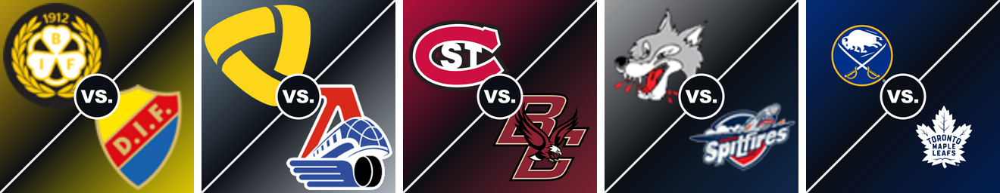

# OnHockey.tv RPC

Discord Rich Presence for [onhockey.tv](https://onhockey.tv/): your Discord status shows the hockey game you're watching, with the live score, period and time remaining.


- **Line 1:** the game, e.g. `Canadiens vs Capitals`
- **Line 2:** live score + period + clock, e.g. `MTL 3 – 3 WSH · 3e période · 12:20`, `2e entracte · 4:51`, `Final (prol.)`
- **Image:** a matchup poster built from both teams' logos, with the league logo as the small image
- **Goals:** for about a minute after a goal, the status shows who scored and the assists, with a flashing goal light



Your status line shows the teams (« Canadiens vs Capitals ») and the activity card is titled with `activityName` from `config.json`. Hovering the image shows the full team names and shots on goal. A « Gamecenter NHL.com » button and the time you've been watching are shown too. The presence text is in French.

onhockey.tv lists **134 leagues** over a season. Score, period and poster work for 53 of them:

| Leagues | Source | Details |
| --- | --- | --- |
| NHL | Official NHL API | score, period, clock, shots, scorer and assists |
| AHL, ECHL, SPHL, PWHL, OHL, WHL, QMJHL, Memorial Cup, USHL and the Canadian Junior A leagues (OJHL, GOHL, CCHL, EOJHL, MHL, MJHL, SJHL, AJHL, BCHL, BCHC, PJHL, VIJHL, NWJHL) | HockeyTech (the leagues' official stats) | score, period, clock, scorer and assists |
| NCAA D1 men and women | ESPN | score, period, clock |
| KHL, Champions League, Asia League | 365Scores | score, period |
| SHL, HockeyAllsvenskan, HockeyEttan, Liiga, Mestis, Suomi-sarja, Metal Ligaen, EHL, Czech Extraliga, Maxa Liga, Tipsport Liga, National League, Swiss League, DEL, DEL 2, Ligue Magnus, ICEHL, AlpsHL, IHL, Erste Liga, Polish Hokej Liga, UHL, EIHL, Belarus Extraleague, Pro Hokei Ligasy | LiveScore | score, period, scorer and assists |

The other leagues (FPHL, VHL and Russian junior leagues, European women's and U20 leagues…) show the teams with the league logo. **[See every league →](docs/LEAGUES.md)**

### Goal alerts

When the score changes, the status switches for about a minute to the goal: `🚨 BUT ! Pontus Holmberg (4)` and `Filet désert · Aides : A. Cirelli (4), B. Hagel (8) · WPG 4 – 6 TBL`, with a flashing red goal light as the small image. Scorer and assists come from the NHL API, HockeyTech and LiveScore. For KHL and NCAA games, the alert shows the team that scored.

### League logos

The small image is the league's logo; when no team logos exist for a game, the league logo becomes the large image (with no small image). Each league's logo comes from, in order:

1. an **Art Asset of the Discord application** named after the league's id in [`src/leagues.js`](src/leagues.js) (e.g. `khl`, `metal_ligaen`)
2. a file **`assets/<id>.png`** in this folder
3. the league's logo on **Wikipedia** ([`src/league-logo-urls.json`](src/league-logo-urls.json), refreshed with `node scripts/resolve-league-logos.js`)
4. a **generated badge** with the league's initials

Leagues are recognized by the icon onhockey.tv shows next to their name, so look-alike names (« SHL » in Sweden and Slovakia, « OHL » in Ontario and Latvia, « MHL » in Russia and the Maritimes) get the right logo.

## Requirements

- Windows 10 or 11
- The **Discord desktop app** (Discord in a web browser can't show Rich Presence)
- A Chromium browser: **Chrome, Edge, Brave or Opera**
- Node.js 20 or newer. If it's missing, the installer offers to install it.

## Installation

**1. Download**

Click **Code → Download ZIP** at the top of this page, then extract it to a folder you'll keep (for example `Documents\OnHockey.tv-RPC`).
If you use git: `git clone https://github.com/TheUnknownMurda/OnHockey.tv-RPC.git`

> Don't move the folder after installing. If you do, run `install.bat` again and reload the extension.

**2. Run `install.bat`**

Double-click `install.bat` and answer the questions. It:

1. checks Node.js and installs it if needed
2. installs the dependencies
3. asks if OnHockey.tv RPC should start with Windows (recommended)
4. starts OnHockey.tv RPC in the background
5. copies the extension folder path to your clipboard and opens your browser's extensions page

**3. Load the browser extension**

On the extensions page that opened (`chrome://extensions` or `edge://extensions`):

1. Turn on **Developer mode** (top right in Chrome, left menu in Edge)
2. Click **Load unpacked**
3. Paste the path from your clipboard (`Ctrl+V`) in the folder box, or select the `extension` folder yourself
4. Pin the extension (puzzle icon → pin): its popup shows whether everything is connected


**That's it.** Open Discord, go to onhockey.tv, click a game, then a stream link: your status updates within a few seconds.

## Usage

The presence appears when you click a stream link on onhockey.tv. It disappears when you close the tab, go back to the onhockey.tv home page, or about 45 s after closing the browser. Opening a stream in a new tab (middle-click) works too.

| File | What it does |
| --- | --- |
| `install.bat` | Installs or repairs OnHockey.tv RPC (safe to run again) |
| `start.bat` | Restarts OnHockey.tv RPC in a window where you can see the logs |
| `stop.bat` | Stops OnHockey.tv RPC and clears your Discord status |
| `uninstall.bat` | Stops OnHockey.tv RPC and removes it from Windows startup |

## Troubleshooting

Click the extension icon first: the popup tells you what's wrong.

| Problem | Fix |
| --- | --- |
| Popup: *App: not found* | OnHockey.tv RPC isn't running. Run `start.bat`; the window shows any error. |
| Popup: *Discord: not connected* | Open the Discord desktop app. OnHockey.tv RPC reconnects by itself within 15 s. |
| Everything is connected but nobody sees the status | Discord → User Settings → **Activity Privacy** → turn on **Share your detected activities with others**. |
| No score shown | No free source covers that league (see [docs/LEAGUES.md](docs/LEAGUES.md)). The log says « aucune source pour … ». |
| A league shows the wrong logo or a badge | Add `assets/<id>.png` (id from [`src/leagues.js`](src/leagues.js)) or upload an Art Asset with that name to your Discord application, then restart with `start.bat`. |
| The image is the default one instead of the logos | The poster couldn't be uploaded. Check `onhockey-tv-rpc.log`; it's retried the next time you watch that game. |
| The extension doesn't react, or the wrong league logo shows | After moving the folder or updating the files, click the reload ↻ button on the extension in the extensions page, then reload onhockey.tv. |
| Chrome warns about developer-mode extensions | That's normal for extensions loaded from a folder. Keep it enabled. |

Logs are written to `onhockey-tv-rpc.log` in the OnHockey.tv RPC folder.

## Configuration

Edit `config.json`, then run `start.bat` (or `stop.bat` + `install.bat`) to apply.

To preview the goal alert while a game is shown in your status, run `curl -X POST -H "X-OnHockey-RPC: 1" http://127.0.0.1:47823/test-goal` (it replays the game's last goal).

| Key | Description |
| --- | --- |
| `clientId` | Discord application ID |
| `activityName` | Title of the activity card (« Watching OnHockey.tv RPC »). Your status line always shows the teams. |
| `pollSeconds` | Score refresh interval, in seconds |
| `generateMatchupImage` | `false` always uses `fallbackImage` |
| `fallbackImage` | Image used when no matchup poster is available |
| `freeimageApiKey` | Your own [freeimage.host](https://freeimage.host/page/api) API key (optional) |
| `showElapsed` | Shows how long you've been watching |
| `showLeagueBadge` | League logo as the small image over the matchup poster |
| `goalAlerts` | Goal alerts (scorer, assists, goal light) |
| `goalAlertSeconds` | How long the goal alert stays, in seconds |
| `goalLightImage` | URL of your own goal light image or GIF (empty: the built-in one, `assets/goal-light.gif`) |
| `showGamecenterButton` | « Gamecenter NHL.com » button |
| `port` | Local port used by the extension. If you change it, also change it in `extension/background.js`, `extension/manifest.json`, `extension/popup.js` and `stop.bat`. |

## How it works

```
onhockey.tv ──(extension)──▶ OnHockey.tv RPC (local app) ──▶ Discord (IPC)
                                   │
                                   ├─ NHL API / HockeyTech / ESPN / 365Scores / LiveScore: score, period, clock
                                   ├─ league logos: Discord assets / assets/ / Wikipedia / generated badge
                                   └─ posters and logos (sharp) → hosted on freeimage.host
```

1. The **extension** detects the stream link you click on onhockey.tv and reads the game (`Montréal - Washington`), its league and the league's icon.
2. The **local app** (Node.js) picks a data source from the league, finds the game by team names (tolerant to spelling variants like « Brynäs » / « Brynaes »), refreshes the score every 15 s, spots goals and updates Discord.
3. Each matchup poster is generated once from the teams' logos and uploaded, because Discord only displays images from public URLs. The URL is cached in `cache/matchups.json`.

## Notes

- **Spoilers:** streams are often 30–60 s behind live TV. The score comes from the NHL API, so it can be ahead of your video.
- **Privacy:** OnHockey.tv RPC only listens on `127.0.0.1` and only reacts to its own extension. It sends nothing except the matchup posters and league logos to freeimage.host.
- **Why the posters are built from logos instead of AI-generated:** image generators distort logos. Building the poster from the real logos gives an exact result for every team.
